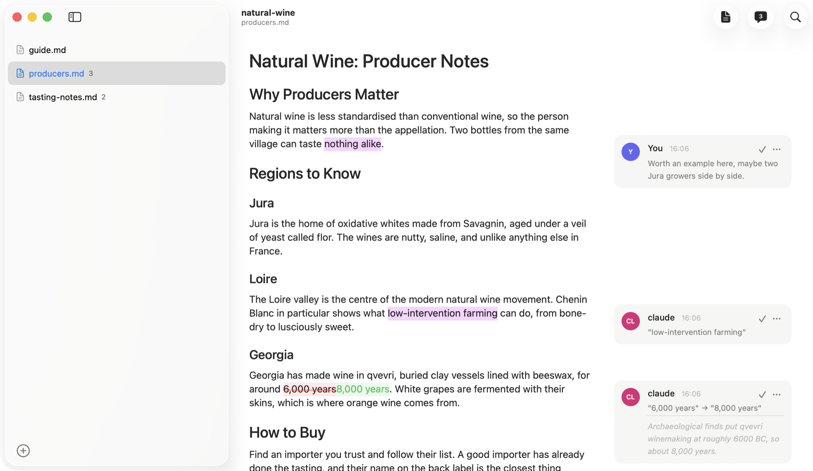

  

<h1 align="center">Folio</h1>

**Review markdown with an AI agent, without letting it touch your file.**

Folio is a local markdown editor built for review. An agent reads a document and leaves its feedback as annotations: replacements, deletions, insertions, highlights and comments. You see them beside the text as they arrive, reply to them, and accept or reject each one. Accepting patches the markdown; nothing else ever changes it.

<picture>
  <source media="(prefers-color-scheme: dark)" srcset="docs/images/screenshot-dark.png">
  
</picture>

## Ways to use it

- **macOS app.** A native window for each document, or for a whole set of files with a sidebar. It opens in a rendered preview, with the markdown source one click away for editing. Mermaid blocks are drawn as diagrams, and PlantUML ones too [with a setting](docs/guides/plantuml.md). `folio open <file>` launches it from the terminal.
- **MCP.** The app is also an MCP server for Claude Desktop, Codex, Claude Code, Cursor and other clients: **Folio ▸ Connect to MCP Clients…** sets them up. It can see which annotation you are on. See [MCP](docs/mcp.md).
- **Command line.** `folio review`, `accept`, `reject`, `annotate` and more work on the same annotations from scripts, CI or an agent, on any platform. `folio --help` lists everything.
- **Sets.** Group files from different folders or repositories under a name and review them together, with a pending count per file. See [sets](docs/guides/sets.md).
- **Notes next to the review.** Add a folder of markdown to a set and it becomes a wiki beside the files under review:
  - links to annotations and passages;
  - backlinks on the cards;
  - an Open list of the task items tagged `#investigate`, `#waiting` or `#replied`.

  See [wiki mode](docs/features/wiki-mode.md).

## Using it with an agent

1. **Ask your agent to review a file.** For example: *"Review docs/spec.md for clarity and annotate it with Folio."* The agent writes annotations to the file's sidecar. It never edits the `.md` itself.
2. **Open the document** in the app. Annotations appear in the text and as cards beside it, and update live while the agent works.
3. **Triage.** Accept or reject each suggestion, dismiss comments, and reply on any card.
4. **Hand it back.** Your replies and decisions are in the same sidecar, so the agent can continue where you left off.

This repository ships a Claude Code skill, [`.claude/skills/folio`](.claude/skills/folio/SKILL.md), that teaches an agent the whole workflow. Copy it into `~/.claude/skills/` to use it in any project. Any other agent can follow the [sidecar format](docs/reference/sidecar-format.md) directly, since it is plain JSON. More in [reviewing with an agent](docs/guides/agent-review.md).

## How it works

Annotations live in a JSON sidecar, one per markdown file, under `.folio/` at the root of your repository. The markdown stays clean. Each annotation names the text it is about with a snippet of the text before it (`context_before`) and the text itself (`target`), so it keeps pointing at the right place when the document is edited around it.

| Kind | Meaning | Accepting it |
|---|---|---|
| `replace` | Suggest new text for a passage | Swaps the text |
| `delete` | Suggest removing a passage | Removes it |
| `insert` | Suggest adding text at a point | Inserts it |
| `highlight` | Draw attention to a passage | Resolves it |
| `comment` | Discuss a passage | Dismisses it |

Every annotation records who wrote it (`local`, `agent`, or an imported review source) and can carry a thread of replies. The full format is in the [sidecar format](docs/reference/sidecar-format.md).

## Build

`cargo build` builds the `folio` command-line tool; it needs Rust. The macOS app is a Swift package on top of the Rust library and a small frontend page that draws diagrams (Node with pnpm). `scripts/verify.sh` builds everything and runs all the tests. The steps are in [development](docs/development.md).

## Documentation

The [docs](docs/README.md) are the project's wiki: guides, reference, how it is built, the decisions behind it, and what is still open.
