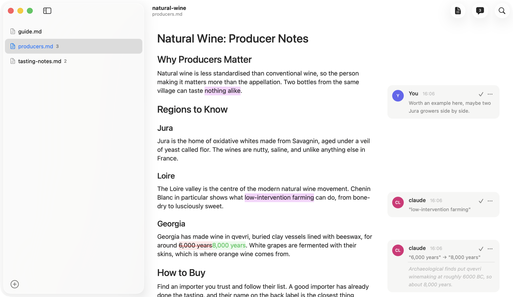

  

<h1 align="center">Folio</h1>

**Review markdown with an AI agent, without letting it touch your file.**

Folio is a local markdown editor built for review. An agent reads a document and leaves its feedback as annotations: replacements, deletions, insertions, highlights and comments. You see them beside the text as they arrive, reply to them, and accept or reject each one. Accepting patches the markdown; nothing else ever changes it.

## Ways to use it

- **macOS app.** A native window for each document, or for a whole set of files with a sidebar. It opens in a WYSIWYG preview, with a source view one click away. `folio open <file>` launches it from the terminal. See [macos/README.md](macos/README.md).
- **MCP.** The app is also an MCP server: **Folio ▸ MCP ▸ Add to Claude Desktop** or **Add to Codex**, restart the tool, and ask it to review a markdown file. It can see which annotation you are on; **Other Tools…** shows how to connect Claude Code, Cursor and other MCP clients. See [macos/README.md](macos/README.md#mcp).
- **Command line.** `folio review`, `accept`, `reject` and `annotate` work on the same annotations from scripts, CI or an agent, on any platform. `folio --help` lists everything.
- **Sets.** Group files from different folders or repositories under a name (`folio set`) and review them together, with a pending count per file.

Fenced `mermaid` blocks render as diagrams, and tables are editable.

## Using it with an agent

1. **Ask your agent to review a file.** For example: *"Review docs/spec.md for clarity and annotate it with Folio."* The agent reads the markdown and writes annotations to its sidecar. It never edits the `.md` itself.
2. **Open the document** in the app. Annotations appear as highlights in the text and as cards in the comments pane, and update live while the agent works.
3. **Triage.** Accept a replacement, deletion or insertion to apply it to the file, reject it to discard it, or dismiss a comment. You can reply on any card to start a thread.
4. **Hand it back.** Replies and resolved annotations are stored in the same sidecar, so the agent can read your answers and continue where you left off.

This repository ships a Claude Code skill, [`.claude/skills/folio`](.claude/skills/folio/SKILL.md), that teaches an agent the whole workflow: how to find the sidecar, how to anchor annotations to the right text, and how to check its own work. Copy it into `~/.claude/skills/` to use it in any project. Any other agent can follow the [sidecar specification](folio-sidecar-spec.md) directly, since it is plain JSON.

## How it works

Annotations live in a JSON sidecar, one per markdown file, under `.folio/` at the root of your repository. The markdown stays clean. Each annotation names the text it is about with a snippet of the text before it (`context_before`) and the text itself (`target`), so it keeps pointing at the right place when the document is edited around it.

| Kind | Meaning | Accepting it |
|---|---|---|
| `replace` | Suggest new text for a passage | Swaps the text |
| `delete` | Suggest removing a passage | Removes it |
| `insert` | Suggest adding text at a point | Inserts it |
| `highlight` | Draw attention to a passage | Resolves it |
| `comment` | Discuss a passage | Dismisses it |

Every annotation records who wrote it (`local`, `agent`, or an imported review source) and can carry a thread of replies. The full format is in [folio-sidecar-spec.md](folio-sidecar-spec.md).

## Build

Folio needs Rust, and Node with pnpm for the app's editor. `cargo build` builds the `folio` command-line tool. The macOS app is a Swift package built on top of that and of the frontend; [macos/README.md](macos/README.md) has the steps. `scripts/verify.sh` builds everything and runs all the tests.
