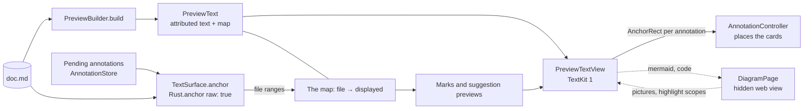

# The native preview

`macos/Sources/Folio/Preview/`. The preview is read-only: hand edits go through the [source editor](macos-app.md#source-editor).

How a file becomes the preview, and how an annotation finds its place in it. Anchoring happens in the markdown; the map turns file positions into displayed ones.

- `PreviewBuilder` turns the markdown into an attributed string.
- `PreviewText` keeps the map between displayed and file characters. Both are in FolioKit. Anchors and selections go through the map to `Rust.anchor(raw: true)` / `Rust.renderedSelection`, as in the source.
- `PreviewView` owns:
  - the `PreviewTextView` (TextKit 1, laid out at full height inside `EditorScrollView`; see [scrolling](macos-app.md#scrolling));
  - the text column (`column`, 760 pt; paragraphs are indented by `side`, and only tables and `folioWide` pictures may be wider);
  - pictures and code colours.
- `DiagramPage` is the hidden web view that draws mermaid and highlights code (the [frontend](overview.md#frontend-frontendsrc)). It sits in a transparent off-screen window that must never show.
- PlantUML is drawn by a local command or a server, if one is set ([guide](../guides/plantuml.md)).

## Pitfalls

Rules learned the hard way:

- **Paint from the column.** Blocks painted behind the text (`PreviewTextView.drawBackground`: code, the frontmatter box, quote bars, rules) are placed from the text column (`columnInset`). Never place them from a block's bounding rect, which can reach outside the column.
- **Marks never cross a line break.** Annotation marks are temporary attributes (`TextSurface.applyMarks`), drawn line by line. The background of a line break runs to the edge of the line, outside the column.
- **Floating things stay in view.** Anything floating (the open card, the form, the Comment button) is kept inside `visibleDocumentRect` and the text column (`CardLayout.floatingOrigin`), even when the text is at the bottom of the window.
- **Copy the text first.** `PreviewText.text` is a reference: copy it before inserting suggestion previews.
